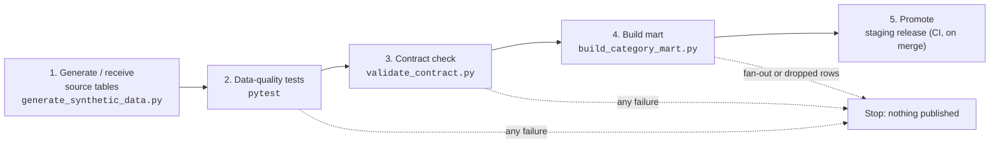

# Meridian Grocery Co-op: Daily Units by SKU by Store

Quality gates, tests, a data contract and a CI/CD promotion path for the
category managers' morning report.

## Purpose

Meridian Grocery Co-op runs 40 stores across the Midwest. Its category managers
start each day with **units sold by SKU by store for the previous business day,
with promotion flags**, and the table must be refreshed **before 07:00 Central**.
They use it to read promo lift on the weekly ad, spot items falling off, and set
replenishment and markdowns for perishables.

Last quarter a duplicate store code in the store reference table fanned out a
join and doubled one store's units in that report for eleven days, which
overstated promo lift and drove over-orders on perishables that ended as waste.
This repository blocks that failure class, and its neighbours, before a change
or a bad delivery reaches the published table:

- a seeded generator for a realistic synthetic store-sales dataset, with known defects;
- a pytest + pandera data-quality suite (schema, keys, nulls, referential integrity,
  join cardinality, business rules);
- a machine-readable producer-consumer **data contract** with a 07:00 freshness SLA
  and a breaking-change policy, plus its validator;
- the **mart builder** that publishes `category_daily_units`, with promo lift, and
  refuses to publish if any join would fan out or drop rows;
- a GitHub Actions gate that blocks bad pull requests and promotes good merges to
  a staging release.

### Grocery-domain mapping

| Concept | Where it lives |
|---|---|
| Store | `store_reference` (store code, format, region) |
| Item / SKU | `sku_master` (department, category, perishable flag, shelf life) |
| Planogram | `planogram`: one shelf slot per store and SKU, with location, set and removal dates, regular price |
| Units sold, net sales | `daily_sku_sales.units_sold`, `net_sales` |
| Basket | `daily_sku_sales.basket_count`: customer transactions containing the SKU |
| Promotion flag | `daily_sku_sales.promo_flag`, `promo_id` (weekly ad event) |
| Promo lift | `category_daily_units.promo_lift_pct`, against `baseline_units` |
| Shrink | `daily_sku_sales.shrink_units`: theft, damage, scan error |
| Perishable waste | `daily_sku_sales.waste_units`: product pulled past its sell-by date |

## Repository layout

| Path | What it is |
|---|---|
| `scripts/generate_synthetic_data.py` | Seeded generator for the four source tables |
| `scripts/build_category_mart.py` | Builds the published `category_daily_units` table |
| `data/synthetic/` | Committed **defective** dataset, `manifest.json` of injected defects, and a [data README](data/synthetic/README.md) |
| `tests/` | pytest + pandera data-quality suite and mart unit tests |
| `contracts/store_sku_sales.yaml` | Data contract for `planogram` and `daily_sku_sales` |
| `validate_contract.py` | Validates a payload (and optionally a contract change) against a contract |
| `requirements.txt` | Pinned dependencies |
| `pytest.ini` | pytest configuration, including the pinned validation time |
| `.github/workflows/quality-gate.yml` | CI gate on pull requests; staging promotion and release tag on merge |
| `.github/rulesets/protect-main.json` | Branch ruleset for `main`: PR required, both gate checks required |

## Prerequisites

- Python 3.12 or later (CI uses 3.12)
- Git, with `origin/main` fetched if you want the contract change-policy test to run
- About 300 MB of disk for the virtual environment and a clean build
- Optional: the GitHub CLI (`gh`) for the ruleset import and the rollback runbook

No credentials are needed. Nothing in this repository connects to a database or
external service; contact addresses in the contract are placeholders on the
reserved `.example` domain.

## Setup

```
git clone https://github.com/jeffmoe/CST_660_Meridian_Grocery.git
cd CST_660_Meridian_Grocery
python -m venv .venv
.venv\Scripts\activate          # macOS/Linux: source .venv/bin/activate
pip install -r requirements.txt
```

## Run order



Each step runs only if the one before it passed. Locally, on a clean dataset:

```
python scripts/generate_synthetic_data.py --clean --out build/data
pytest --data-dir=build/data
python validate_contract.py contracts/store_sku_sales.yaml build/data --now 2026-10-28T07:00
python scripts/build_category_mart.py --data-dir build/data --out build/mart/category_daily_units.csv
```

Step 5 runs only in CI after a merge to `main` (see [CI/CD](#cicd-quality-gate-and-promotion)).
In production, step 1 is the nightly store-systems extract, and the schedule
that meets the 07:00 SLA is: stores close and POS polls by 02:00, extract lands by
04:30, gate and contract by 05:30, mart published by 06:30.

To run the same commands against the committed **defective** dataset, drop the
`--clean`/`--data-dir` arguments: steps 2–4 then fail as described under
[Expected results](#expected-results).

## Data dictionary

All five tables are published: the four source tables as the contract's payload
(the contract covers `planogram` and `daily_sku_sales`), and `category_daily_units`
as the table category managers read. Dates are `YYYY-MM-DD`; booleans are
`True`/`False`; money is USD.

### `store_reference`: one row per store

| Column | Type | Null | Description |
|---|---|---|---|
| `store_code` | string `^ST\d{3}$` | no | Store ID. **Primary key** |
| `store_name` | string | no | Display name, e.g. `Meridian Des Moines` |
| `city` | string | no | City |
| `state` | string `^[A-Z]{2}$` | no | US state |
| `region` | enum | no | `Central`, `East`, `North`, `South`, `West`; merchandising region |
| `store_format` | enum | no | `SUPERMARKET`, `NEIGHBORHOOD`, `EXPRESS` |
| `opened_date` | date | no | Date the store opened |
| `is_active` | boolean | no | Store currently trading |

### `sku_master`: one row per SKU

| Column | Type | Null | Description |
|---|---|---|---|
| `sku` | string `^\d{6}$` | no | Item number. **Primary key** |
| `item_description` | string | no | Brand plus item, e.g. `Meridian Select 2% Milk Gallon` |
| `brand` | string | no | National brand or the private label `Meridian Select` |
| `department` | enum | no | `PRODUCE`, `DAIRY`, `MEAT_SEAFOOD`, `BAKERY`, `GROCERY`, `FROZEN`, `HOUSEHOLD` |
| `category` | string `^[A-Z_]+$` | no | Category managed by one category manager, e.g. `FRESH_FRUIT`, `SNACKS` |
| `unit_of_measure` | enum | no | `EA` (each) or `LB` (sold by weight) |
| `is_perishable` | boolean | no | Item has a sell-by date; only perishables record waste |
| `shelf_life_days` | integer 1–365 | yes | Days from receipt to sell-by. Set exactly when `is_perishable` is `True` |
| `launch_date` | date | no | Date the item entered the co-op's item file |

### `planogram`: one row per store-SKU shelf slot

| Column | Type | Null | Description |
|---|---|---|---|
| `planogram_id` | string `^PG\d{8}$` | no | Slot ID. **Primary key** |
| `store_code` | string | no | → `store_reference.store_code` |
| `sku` | string | no | → `sku_master.sku` |
| `shelf_location` | enum | no | `AISLE`, `ENDCAP`, `COOLER`, `FREEZER`, `PRODUCE_TABLE`, `BAKERY_CASE` |
| `set_date` | date | no | Date the item was set on this store's shelf |
| `removal_date` | date | yes | Date the item was pulled; null while `ACTIVE`, set exactly when `REMOVED`, on or after `set_date` |
| `status` | enum | no | `ACTIVE` or `REMOVED` |
| `regular_price` | decimal 0.01–99.99 | no | Everyday shelf price per unit of measure, before promotions |

### `daily_sku_sales`: one row per slot per business date while on the shelf

| Column | Type | Null | Description |
|---|---|---|---|
| `planogram_id` | string | no | → `planogram.planogram_id`. **Primary key** with `business_date` |
| `business_date` | date | no | Store trading day (Central time) |
| `units_sold` | integer 0–2,000 | no | Units scanned, net of returns. Weight items count whole pounds |
| `net_sales` | decimal 0–50,000 | no | Sales after promotional discount, before tax |
| `basket_count` | integer 0–2,000 | no | Transactions containing the SKU; ≤ `units_sold` |
| `promo_flag` | boolean | no | SKU on a weekly ad promotion in this store on this date |
| `promo_id` | string `^PR\d{6}$` | yes | Ad event; set exactly when `promo_flag` is `True` |
| `shrink_units` | integer 0–500 | no | Units lost to theft, damage or scan error |
| `waste_units` | integer 0–500 | no | Perishable units pulled past sell-by; 0 for non-perishable SKUs |

### `category_daily_units`: one row per business date, store and SKU (the published mart)

Built by `scripts/build_category_mart.py`; 165,644 rows on a clean dataset.
**Primary key:** `business_date`, `store_code`, `sku`.

| Column | Type | Null | Source / rule |
|---|---|---|---|
| `business_date` | date | no | `daily_sku_sales` |
| `store_code`, `store_name`, `region`, `store_format` | string | no | `store_reference`, via `planogram.store_code` |
| `sku`, `item_description`, `department`, `category`, `is_perishable` | string / boolean | no | `sku_master`, via `planogram.sku` |
| `units_sold`, `net_sales`, `basket_count` | integer / decimal / integer | no | `daily_sku_sales` |
| `promo_flag`, `promo_id` | boolean / string | `promo_id` yes | `daily_sku_sales` |
| `baseline_units` | decimal | yes | Mean `units_sold` for the slot on non-promotion days in the delivered window; null if the slot had none |
| `promo_lift_pct` | decimal | yes | `(units_sold / baseline_units − 1) × 100` on promotion days; null on non-promotion days and when `baseline_units` is 0 |
| `shrink_units`, `waste_units` | integer | no | `daily_sku_sales` |

Rolling up: sum `units_sold`, `net_sales`, `shrink_units` and `waste_units` freely;
do **not** sum `basket_count` across SKUs (a basket with milk and bread would count
twice), and average `promo_lift_pct` only within one `promo_id`.

## Tests and validation checks

```
pytest                                      # test the committed defective data/synthetic
pytest --data-dir=path/to/other/csvs        # test another dataset
```

`MERIDIAN_DATA_DIR` works in place of `--data-dir`. Write the option with `=`:
given as two separate arguments, pytest mistakes the directory for a test path.

| Module | Checks |
|---|---|
| `test_schema.py` | Pandera schema per table: exact column set and order, every value parses as its declared type, ID formats, allowed values, numeric ranges, and cross-column rules (removal after set date and only on removed slots, shelf life only on perishables, `basket_count ≤ units_sold`, `promo_id` set exactly when `promo_flag`) |
| `test_primary_keys.py` | Key uniqueness: `store_code`, `sku`, `planogram_id`, and `(planogram_id, business_date)` |
| `test_not_null.py` | Not-null on every required column, one test per column (31 tests) |
| `test_referential_integrity.py` | `planogram.store_code → store_reference`, `planogram.sku → sku_master`, `daily_sku_sales.planogram_id → planogram` |
| `test_join_cardinality.py` | Row-count assertion: joining `planogram` to `store_reference` (left and inner) must return exactly one row per slot |
| `test_business_rules.py` | (1) No slot-day sells more than 10× the slot's median daily units. Slots set or removed inside the window are excluded (cut-in ramps and clearance run-downs legitimately exceed it), and only slots with a median of at least 3 units are evaluated. (2) `waste_units` is only non-zero on perishable SKUs |
| `test_contract.py` | Runs the [data contract](#data-contract): the contract file is well formed, the payload satisfies every clause, and any edit to the contract follows the breaking-change policy relative to the version on `origin/main` |
| `test_category_mart.py` | Unit tests of the mart builder on a hand-built dataset: one row per sales row with the right attributes, promo-lift arithmetic, and refusal on a duplicate store key, duplicate planogram key, unmatched store, or two slots for one store and SKU |

Each failure is reported by one test only: schemas leave columns nullable so
nulls fail only the not-null tests, and foreign-key tests skip null keys. The
mart unit tests use their own data, so they pass on any `--data-dir`.

Every data test prints the rows that violated it, indexed by `csv_line` (the line
in the source CSV), under *Captured stdout call*. A join failure also prints the
`store_reference` rows that caused it:

```
planogram rows before join: 4037; after left join: 4170
FAIL  planogram left-joined to store_reference keeps one row per slot: 133 violating row(s)
...
FAIL  store_reference rows behind the change: 2 violating row(s)
         store_code                     store_name         city state   region store_format ...
csv_line
18            ST017           Meridian Minneapolis  Minneapolis    MN    North  SUPERMARKET ...
19            ST017  Meridian Minneapolis (Uptown)  Minneapolis    MN  Central  SUPERMARKET ...
```

### Expected results

**Committed defective dataset** (`pytest`): 9 of 55 tests fail, 45 pass, 1 is skipped.

| Failing test | Injected defect |
|---|---|
| `test_primary_key_is_unique[store_reference]` | Duplicate `ST017` key |
| `test_join_to_store_reference_preserves_row_count[left]` | `ST017` fan-out (4,037 → 4,170 rows) |
| `test_join_to_store_reference_preserves_row_count[inner]` | `ST017` fan-out plus 5 orphan slots dropped (4,037 → 4,165 rows) |
| `test_primary_key_is_unique[planogram]` | 3 duplicated planogram IDs |
| `test_foreign_key_resolves[planogram.store_code->store_reference.store_code]` | 5 orphan store codes |
| `test_schema_and_data_types[planogram]` | Malformed store code `ST7` |
| `test_required_column_not_null[planogram.sku]` | 4 null SKUs |
| `test_units_sold_within_10x_slot_median` | Decimal-shift spike: 2,800 units posted against a median of 19.5 (143.6×) |
| `test_payload_satisfies_contract` | Null SKUs, `ST7`, duplicate planogram IDs, and the spike breaking the 2,000-unit ceiling (4 contract clauses) |

**Clean dataset** (`pytest --data-dir=build/data` after a `--clean` generate):
54 passed, 1 skipped. The largest units-to-median multiple there is 6.7×, so the
10× threshold has headroom.

**Skipped test:** `test_contract_change_follows_policy` skips until the contract
exists on `origin/main`; from then on it checks every contract edit against that version.

**Contract validator** at `--now 2026-10-28T07:00`:

| Dataset | Exit code | Result |
|---|---|---|
| Defective | `1` | 55 clauses: 50 passed, 4 failed (`planogram.store_code` pattern, `planogram.sku` not null, `planogram` primary key, `daily_sku_sales.units_sold` range), 1 skipped |
| Clean | `0` | 55 clauses: 54 passed, 1 skipped; `CONTRACT SATISFIED`; freshness 7.0 h old against a 31 h limit |

**Mart builder:**

| Dataset | Exit code | Result |
|---|---|---|
| Defective | `1` | `MART NOT BUILT: planogram.planogram_id is not unique (...)`; no file written |
| Clean | `0` | 165,644 rows, 40 stores, 160 SKUs, 2026-09-16 to 2026-10-27; 14,948 promotion rows, median promo lift 111.2% |

## Data contract

`contracts/store_sku_sales.yaml` is the machine-readable agreement between the
Store Systems Data Platform team (producer) and Category Management, Store
Operations and Marketing (consumers). It declares:

| Clause | Content |
|---|---|
| Owner | Producing team, email, Slack channel, escalation address |
| Consumers | Who depends on the data and for what |
| Columns | Name, type (`string`, `date`, `decimal`, `integer`, `boolean`), nullability, patterns for IDs. Each dataset has a primary key and rejects undeclared columns |
| Allowed values | `shelf_location` and `status` enums; `regular_price` 0.01–99.99; `units_sold` and `basket_count` 0–2,000; `net_sales` 0–50,000; `shrink_units` and `waste_units` 0–500 |
| Freshness SLA | Newest `business_date` no more than 31 hours past the end of that day (America/Chicago): yesterday's sales present by 07:00, and still current until the next morning's 07:00 deadline |
| Breaking-change policy | Semver; breaking changes (removing a column, changing a type, making a column nullable, adding or removing an enum value, widening a range, relaxing the SLA, ...) need a major version bump and a change-log notice at least 30 days before they take effect |

```
python validate_contract.py contracts/store_sku_sales.yaml data/synthetic --now 2026-10-28T07:00
python validate_contract.py NEW_CONTRACT.yaml PAYLOAD_DIR --baseline contracts/store_sku_sales.yaml
```

The validator checks that the contract is well formed (pydantic), then checks
every clause against the payload and prints one `[PASS]`/`[FAIL]`/`[SKIP]` line
per clause, with the violating rows (by CSV line) under each failure. With
`--baseline`, it diffs the two contract versions, classifies each change using
the baseline's policy (anything not explicitly non-breaking counts as breaking),
and enforces the version bump and notification window. `--now` pins the
validation time; without it the SLA is measured against the current time, so
the static synthetic data will always be stale.

Exit codes: `0` all clauses pass, `1` any violation, `2` the contract is invalid
or the payload directory is missing.

Two settings in `pytest.ini` control the contract test, and each can be
overridden on the command line:

| Setting | Default | Purpose |
|---|---|---|
| `validation_time` / `--validation-time=` | `2026-10-28T07:00` | Time freshness is measured at. Pinned because the synthetic data is static; set it empty for a live feed |
| `contract_baseline_ref` / `--contract-baseline-ref=` | `origin/main` | Git ref holding the contract in force. If the working-tree contract differs from it, the change must follow the breaking-change policy |

For example, adding a `DISCONTINUED` planogram status as v1.1.0 with a week's
notice fails `test_contract_change_follows_policy`: adding an enum value is
breaking, so it needs v2.0.0 and 30 days' notice to Category Management, Store
Operations and Marketing.

## CI/CD: quality gate and promotion

`.github/workflows/quality-gate.yml` runs on every pull request to `main` and
on every push (merge) to `main`.

| Job | When | What it does |
|---|---|---|
| `quality-gate` | PR and merge | Installs `requirements.txt`, generates a **clean** dataset into `build/data`, runs pytest against it (JUnit report in `build/reports`), runs `validate_contract.py` with the base branch's contract as `--baseline`, then builds the category mart into `build/mart`. Any failing step fails the job. Data, reports and mart are uploaded as the `quality-gate-<sha>` artifact, even on failure |
| `gate-self-test` | PR and merge | Generates the **defective** dataset and requires pytest and the validator to exit `1` and the mart builder to refuse it. If a change weakens a control so the injected defects get through, this job fails |
| `promote` | Merge to `main` only, after both jobs pass | Assembles `staging/<tag>/` with the gate's data, mart and reports, the contract, the validator, `requirements.txt`, `RELEASE.json` and `SHA256SUMS`; publishes it as the `staging-<tag>` artifact in the `staging` environment; pushes an annotated tag `v<contract version>-build.<run number>` (e.g. `v1.0.0-build.12`); and creates a GitHub pre-release with the bundle attached |

The gate runs on a clean dataset because the committed one is defective by
design and would block every PR. The self-test runs on the defective dataset to
prove the gate still catches the failure classes it exists for.
`VALIDATION_TIME` (workflow `env`) pins the freshness check to
`2026-10-28T07:00`, the same as `pytest.ini`.

### Branch protection (ruleset)

`.github/rulesets/protect-main.json` defines the protection for the default branch:

| Rule | Effect |
|---|---|
| Require a pull request | No direct pushes to `main`. 0 approvals required, so a solo maintainer can still merge |
| Required status checks | **Quality gate (tests + contract)** and **Gate self-test (defective data must fail)** must pass on a branch up to date with `main` |
| Block force pushes | History on `main` cannot be rewritten |
| Block deletion | `main` cannot be deleted |

GitHub does not apply ruleset files automatically, so a repository admin
imports it once:

- **Web UI:** Settings → Rules → Rulesets → New ruleset → **Import a ruleset** →
  choose `.github/rulesets/protect-main.json` → Create.
- **CLI:** `gh api repos/jeffmoe/CST_660_Meridian_Grocery/rulesets --method POST --input .github/rulesets/protect-main.json`

A check named in the ruleset must match the workflow job `name:` exactly; rename
a job and every merge waits for a check that never reports.

## Rollback runbook

Two recovery paths: **restore** the previously published release (fast; stops
category managers acting on bad numbers) and **revert** the bad change on `main`
(slower; removes the cause). A restore without a revert is undone by the next
merge, because `promote` republishes whatever `main` builds.

The current staging dataset is the **newest non-draft `v*-build.*` release**.
Tags are never deleted or reused, so every published version stays recoverable.

```
gh release list --limit 10                     # note the bad tag and the one before it
gh release view <tag> --json body,targetCommitish
git log --oneline origin/main -10
```

| Situation | Path |
|---|---|
| A published table is wrong and category managers may already be using it (e.g. promo lift on one store looks doubled) | **A. Restore**, then **B. Revert** |
| A bad change is on `main` but nothing bad was published | **B. Revert** only |
| The bad change edited `contracts/store_sku_sales.yaml` | **A. Restore** if the data is affected, then **C. Roll the contract forward** |
| Unsure | **A. Restore**: it is fast, needs no CI, and is itself reversible |

**A. Restore (about 5–10 minutes, no CI run).**

1. Withdraw the bad release: `gh release edit <bad-tag> --draft=true`.
2. Restore the last good bundle and verify it byte for byte:
   ```
   gh release download <good-tag> --pattern '*.tar.gz' --dir restore
   tar -xzf restore/<good-tag>.tar.gz -C restore
   (cd restore/<good-tag> && sha256sum -c SHA256SUMS)
   ```
3. Confirm it still meets the contract:
   `python validate_contract.py restore/<good-tag>/store_sku_sales.yaml restore/<good-tag>/data --now <day after its newest business date>T07:00`
4. Notify the consumers in the contract which version was withdrawn and which is
   live, so any orders or markdowns set from the bad numbers can be reviewed.

**B. Revert (about 15–30 minutes, two CI runs).** Branch from `main`,
`git revert` the bad commits (newest first; `-m 1` for a merge commit), push,
and open a PR. Both required checks must pass; a revert gets no exemption. The
merge publishes a new `build.<n>` release that supersedes any restore.

**C. Contract changes: roll forward.** Reverting a contract edit moves the
version backwards, which the change-policy test rejects. Restore the previous
clauses by hand, bump the version above the bad one, and add a `change_log`
entry. If restoring the old clauses is itself breaking, it needs a new major
version and 30 days' notice; use path A to protect consumers meanwhile.

### Reading a failing gate

1. Open the failed step's log. The `short test summary info` block lists the
   failing tests; each test's *Captured stdout call* prints the violating rows.
2. **Check the PR diff.** If it touches the generator, the mart builder, the
   contract or the checks, the failure is a code defect in the PR. If it doesn't,
   and the failure appears on new data, it is an upstream data defect: contact
   the owner named in the contract report rather than editing the checks.
3. **Fix the cause, not the check.** Change a check or the contract only when the
   rule itself was wrong, and route any contract change through the change policy.

## Known Limitations and Assumptions

**Data**

- All data is synthetic. Demand, prices, promotions, shrink and waste are drawn
  from simple distributions; volumes, mixes and the 10× spike threshold are tuned
  to this dataset and must be re-baselined against real POS history.
- The committed dataset is defective by design. Use `--clean` for a dataset that
  passes every check.
- `units_sold` is an integer, so weight items (`unit_of_measure = LB`) count whole
  pounds. Real scale data is fractional and would need a decimal column, which is a
  breaking contract change.
- `units_sold` and `net_sales` are net of returns and never negative; voids,
  returns that exceed the day's sales, and tax are not modelled.
- `basket_count` is per SKU. It cannot be summed across SKUs into store traffic.
- Shrink is generated daily from POS volume. In practice most shrink is found at
  inventory counts and booked in arrears, so daily shrink figures understate it.
- Zero-unit days are low demand only; out-of-stocks and phantom inventory are not
  modelled, so a zero cannot be read as "on the shelf but not selling."
- Frozen items are treated as non-perishable and record no waste.

**Promotions and promo lift**

- Promotions are weekly ad events (Wednesday to Tuesday), chain-wide or in a single
  region. Temporary price reductions, coupons, loyalty pricing and multi-buy deals
  are not modelled.
- `baseline_units` is the slot's mean on non-promotion days **within the delivered
  window**, including days after the promotion. It is not seasonally adjusted, does
  not remove the post-promotion dip, and ignores cannibalization and halo effects on
  other SKUs. Lift for a single slow-moving slot-day is noisy; evaluate a promotion
  by aggregating its `promo_id` across stores and days.
- Because the baseline depends on the window, re-running the mart with a different
  window changes historical `promo_lift_pct` values.

**Pipeline and SLA**

- The 07:00 deadline is enforced by the contract's freshness check, not by a
  scheduler. CI runs only on pull requests and merges; production needs an
  orchestrator to run the run order nightly with `validation_time` cleared.
- All 40 stores are assumed to trade on Central time, and a business date is the
  calendar day midnight to midnight.
- The contract covers `planogram` and `daily_sku_sales`. `store_reference` and
  `sku_master` are checked by the test suite only; the mart is protected by the
  builder's own guards and unit tests.
- The planogram holds at most one slot per store and SKU; the mart builder refuses
  a delivery with two.
- The mart (about 24 MB) is not committed; it is written to `build/` and shipped in
  the release bundle.
- Generation is deterministic for a seed only with the pinned package versions;
  a different numpy or pandas version can change the drawn values and the exact
  counts above.
- The branch ruleset must be imported by hand once (see above).
